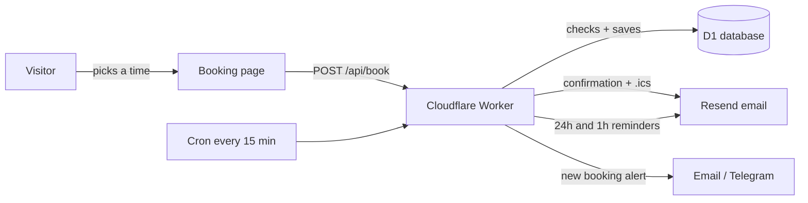

# Cloudflare Booking System

A self-hosted **"book a call"** page for freelancers, consultants and agencies. Visitors pick a time in **their own time zone**, get a confirmation email with a calendar invite, and receive reminders **24 hours and 1 hour** before the call. You get an instant alert by email or Telegram.

It runs on **Cloudflare Workers + D1** (free tier is enough for most people), so there is no server to maintain and no monthly booking-tool subscription.

**Live example:** [nahidreza.com/book](https://nahidreza.com/book) (a production version with an admin panel)


## Features

- **Time-zone aware:** slots are generated in your time zone and shown in the visitor's own time zone automatically
- **No double booking:** a database rule guarantees two people can never take the same slot, even at the same second
- **Your working hours:** choose working days, start and end time, call length, minimum notice and how far ahead people can book
- **Email confirmation with `.ics` calendar invite** (works with Google Calendar, Outlook and Apple Calendar)
- **Automatic reminders** 24h and 1h before the call, including the meeting link if you add one
- **Owner alerts** by email and (optional) Telegram
- **Meeting type:** Google Meet, Zoom or WhatsApp call, with the WhatsApp number required only when needed
- **Spam protection:** hidden honeypot field, origin check and a per-email daily limit
- **Single file, no frameworks:** easy to read and change

## How it works



## Set up (about 10 minutes)

You need a free [Cloudflare](https://dash.cloudflare.com) account and a free [Resend](https://resend.com) account with your domain verified.

```bash
npm install -g wrangler
wrangler login

# 1. Create the database and copy its id into wrangler.toml
wrangler d1 create booking-db
wrangler d1 execute booking-db --file=schema.sql --remote

# 2. Add your email key (and Telegram, if you want alerts there)
wrangler secret put RESEND_API_KEY
wrangler secret put TELEGRAM_BOT_TOKEN   # optional
wrangler secret put TELEGRAM_CHAT_ID     # optional

# 3. Publish
wrangler deploy
```

Then set your name, time zone and working hours at the top of `src/index.js`, and your email addresses in `wrangler.toml`.

## Settings

| Setting | Example | What it does |
|---|---|---|
| `timeZone` | `Asia/Dhaka` | Your time zone |
| `workDays` | `[0,1,2,3,4,6]` | Days you take calls (0 = Sunday) |
| `dayStart` / `dayEnd` | `10:00` / `22:00` | Your working hours |
| `slotMinutes` | `30` | Length of each call |
| `minNoticeHours` | `12` | Earliest someone can book |
| `daysAhead` | `30` | How far ahead people can book |

## Files

```
src/index.js   the Worker: booking page, slots, booking, emails, reminders
schema.sql     database table
wrangler.toml  Cloudflare settings
```

## Want more?

The production version on [nahidreza.com](https://nahidreza.com) adds an admin panel (inbox, calendar, meeting links, replies, trash), lead forms, a blog and live alerts. If you need a booking or client system built for your business, [book a free call](https://nahidreza.com/book).

## License

MIT. Use it, change it, ship it.

Built by [Nahid Reza](https://nahidreza.com).
